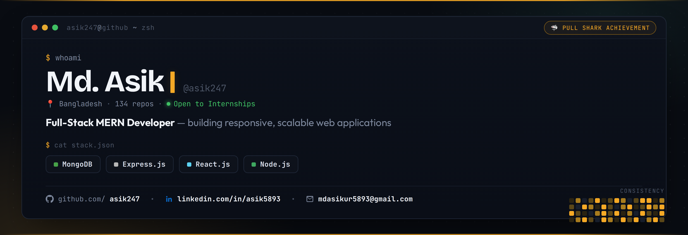
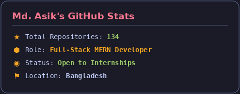
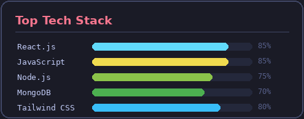

 

 

<table align="center">
<tr>
<td align="center">📍 <b>Bangladesh</b></td>
<td align="center">📦 <b>134 Repos</b></td>
<td align="center">🟢 <b>Open to Internships</b></td>
<td align="center">🕒 <b>UTC +06:00</b></td>
</tr>
</table>

## 🧑‍💻 &nbsp;About Me

> Passionate **MERN Stack Developer** who loves turning ideas into fast, scalable, and beautiful web apps.

I build full-stack applications with **MongoDB, Express, React, and Node.js** — secured with **JWT** and supercharged with **Firebase**. I care about clean, maintainable code and smooth user experiences, and I'm currently sharpening my craft full-time while looking for my first internship.

<table>
<tr><td>

🔭 &nbsp;Currently working on **remote projects**
🌱 &nbsp;Deep-diving into the **MERN stack**, full-time
🎯 &nbsp;Actively looking for an **internship opportunity**
💬 &nbsp;Ask me about **React · Node.js · MongoDB · JWT**
⚡ &nbsp;Fun fact: I debug with `console.log` and I'm proud of it

</td></tr>
</table>

## 🛠️ &nbsp;Tech Arsenal

**Frontend**
 

  

**Backend**
 

  

**Auth & Tooling**
 

 

## 📊 &nbsp;GitHub Analytics

 

 

 

## 📞 &nbsp;Let's Build Something Together

<table>
<tr>
<td align="center" width="150">📍 <b>Location</b> Bangladesh</td>
<td align="center" width="150">📞 <b>Phone</b> 01919-195893</td>
<td align="center" width="150">📧 <b>Email</b> <a href="mailto:mdasikur5893@gmail.com">Send a mail</a></td>
<td align="center" width="150">💼 <b>LinkedIn</b> <a href="https://www.linkedin.com/in/asik5893/">asik5893</a></td>
<td align="center" width="150">🐙 <b>GitHub</b> <a href="https://github.com/asik247">@asik247</a></td>
<td align="center" width="150">▶️ <b>YouTube</b> <a href="https://www.youtube.com/@mdasikdev">@mdasikdev</a></td>
</tr>
</table>

 

### 💡 &nbsp;"Code is like humor. When you have to explain it, it's bad." — Cory House

